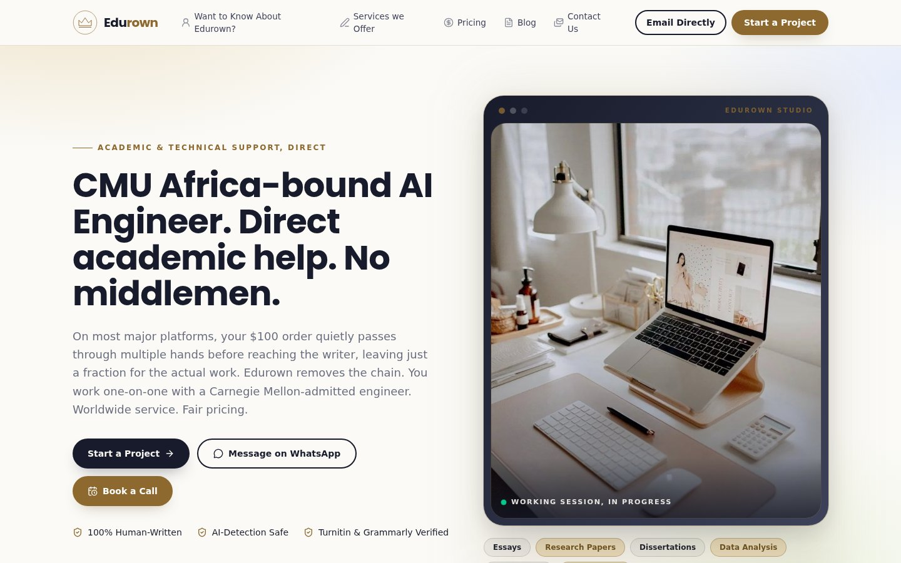
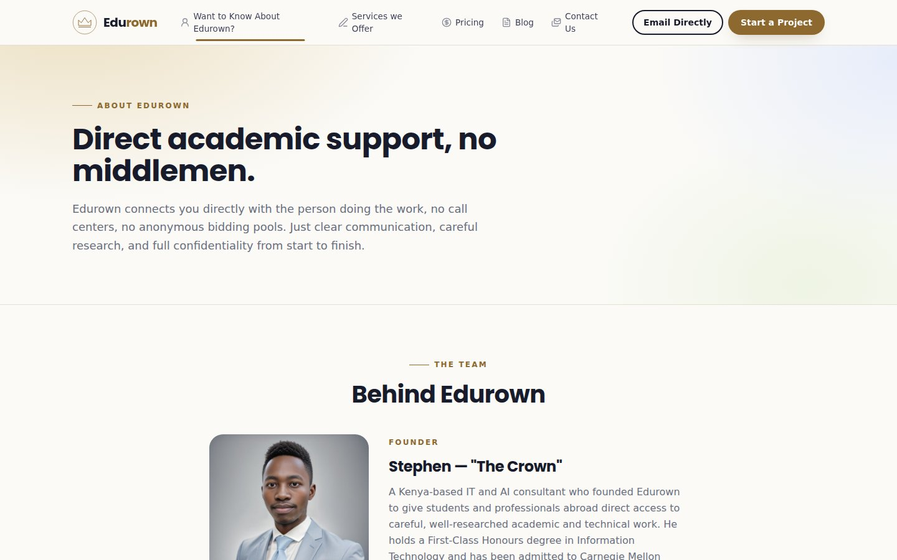
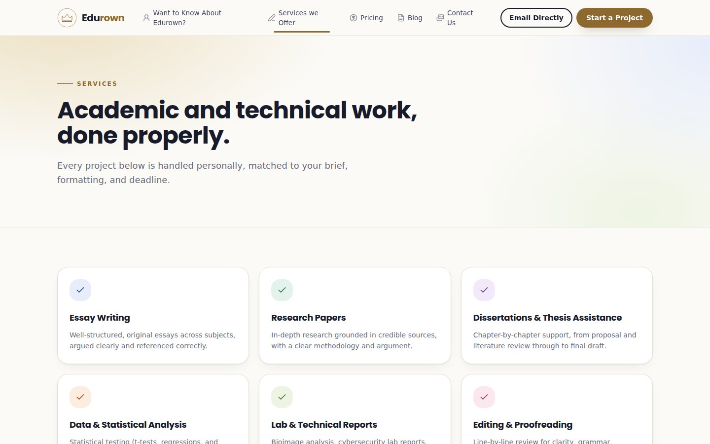
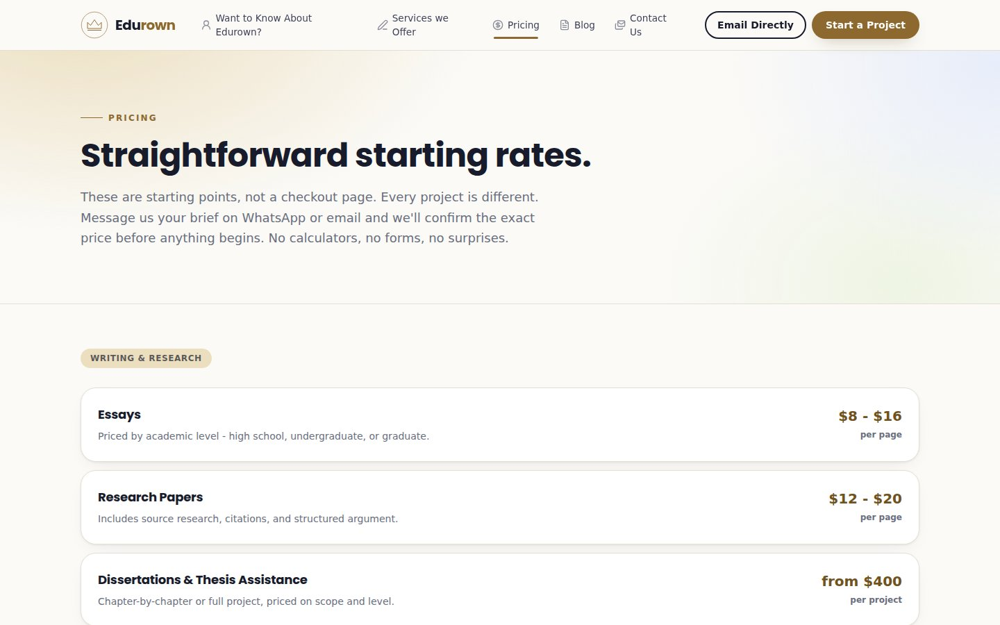
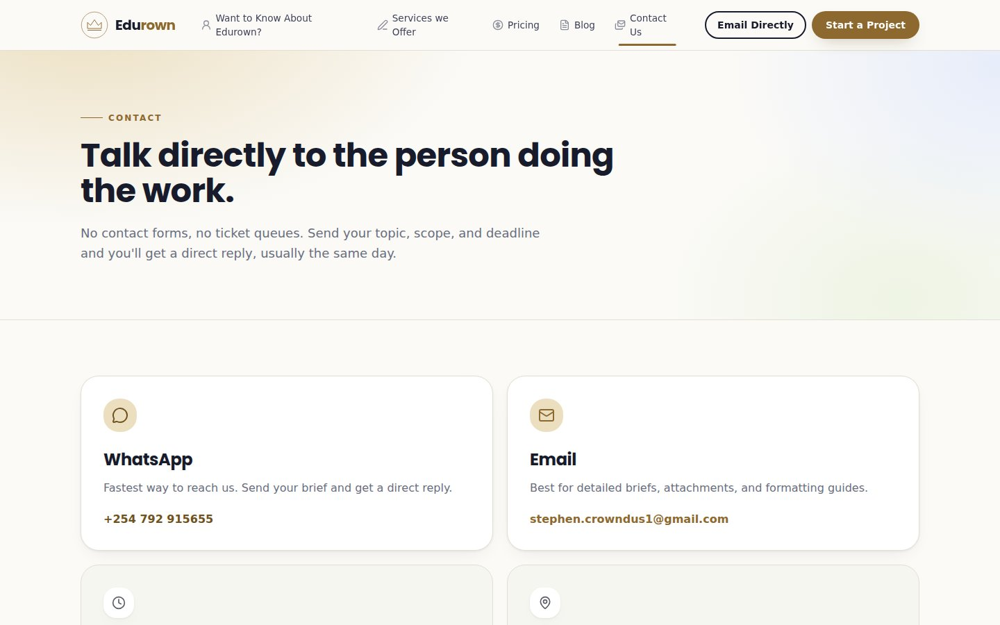

<div align="center">
  <h1>Edurown — Direct Technical Consulting & Software Development</h1>
  
  <p><b>Direct, personal technical consulting and software development for clients worldwide.</b></p>
  <p><i>No middlemen, no bidding pools — just clear communication, custom-built software, and data-driven solutions from start to finish.</i></p>

  <p>
    <a href="https://edurown.vercel.app/">
      
    </a>
    <a href="mailto:stephen.crowndus1@gmail.com">
      
    </a>
    <a href="https://wa.me/254792915655">
      
    </a>
  </p>
</div>

---

### 📌 Overview

Edurown was built to cut through the opaque middleman chain that exists on traditional freelance platforms. When clients pay a premium on platforms like Upwork or Fiverr, the developers and engineers often receive a fraction of the cost. 

Edurown removes the layers — clients pay fair rates, engineers get paid properly, and **high-quality technical execution** is guaranteed.

---

### 🖼️ Preview

<div align="center">
  
</div>

---

### 🚀 Platform Features

*   **💻 Full-Stack Web Development:** Custom web applications built with React, Next.js, and modern backend APIs.
*   **📊 Data Analysis & Machine Learning:** Data pipelines, predictive modeling (Python/Pandas), and interactive dashboards.
*   **📈 Algorithmic Trading & FinTech:** Development of real-time trading bots, WebSocket integrations, and risk-management algorithms.
*   **🔬 Technical Documentation:** System architecture design, API documentation, and technical writing for engineering projects.
*   **✏️ Code Review & Optimization:** Line-by-line review for performance, security, and best practices.
*   **🌍 Worldwide Service:** Comfortable working across time zones and modern development standards.
*   **✨ Premium Motion:** Sitewide scroll-reveal and page-load transitions, with a `prefers-reduced-motion` fallback.

---

### 🛠️ Tech Stack

<div align="center">
  
  
  
  
  
  
</div>

<br/>

| **Category** | **Technologies** |
| :--- | :--- |
| **Framework** | React 19, TanStack Start (SSR), TanStack Router, TanStack Query |
| **Styling** | Tailwind CSS v4, shadcn/ui (Radix primitives) |
| **Build** | Vite, Nitro |
| **Icons** | lucide-react |
| **Hosting** | Vercel |
| **Version Control** | Git & GitHub |

*This is a rebuild of the original static HTML/CSS/JS site on a proper component-based, server-rendered stack — same brand, new foundation.*

---

### 📁 Project Structure

```text
edurown/
├── src/
│   ├── routes/            # File-based routes (/, /about, /services, /pricing, /contact, /blog/*)
│   ├── components/
│   │   ├── site/          # Header, Footer, Hero, Blocks, ScrollReveal, RouteProgress, etc.
│   │   └── ui/            # shadcn/ui primitives
│   ├── data/              # Site copy, services, testimonials, blog posts
│   ├── assets/            # Images (hero photo, founder photo, etc.)
│   ├── hooks/ / lib/      # Shared hooks and utilities
│   └── styles.css         # Design tokens + Tailwind theme
├── public/                # Favicon, robots.txt
├── screenshots/           # README preview images (Home, About, Services, Pricing, Contact)
├── vite.config.ts
└── package.json
```

---

### 📸 Interface Previews

<table>
  <tr>
    <td align="center"><b>Homepage</b><br/></td>
    <td align="center"><b>About</b><br/></td>
  </tr>
  <tr>
    <td align="center"><b>Services</b><br/></td>
    <td align="center"><b>Pricing</b><br/></td>
  </tr>
  <tr>
    <td align="center" colspan="2"><b>Contact</b><br/></td>
  </tr>
</table>

*(Reshoot and replace these anytime the design changes so they don't go stale.)*

---

### 🚀 Getting Started

**Prerequisites:** Node.js 20+ and npm (or bun)

**Local Development:**

```bash
git clone https://github.com/Crowndus/Edurown.git
cd Edurown
npm install
npm run dev
```

**Build:**

```bash
npm run build
npm run preview
```

**Deploy to Vercel:**

Vercel is connected to this GitHub repo, so pushing to the deployed branch redeploys automatically. Vercel auto-detects the Nitro build output — no extra configuration needed. If a fresh import is ever required:

1. Push your changes to GitHub
2. Go to vercel.com → Add New Project → import this repository
3. Framework Preset: leave on auto-detect (or "Other") — Build Command `npm run build`, Install Command `npm install`
4. Click Deploy

---

### 📫 Contact

- **Website:** [edurown.vercel.app](https://edurown.vercel.app/)
- **Email:** stephen.crowndus1@gmail.com
- **WhatsApp:** +254 792 915655
- **GitHub:** [Crowndus](https://github.com/Crowndus)

### 📄 License

This project is licensed under the MIT License — see the `LICENSE` file for details.

<div align="center">
  <p><i>"Solving problems, always. We're getting there."</i> 🚀</p>
</div>
